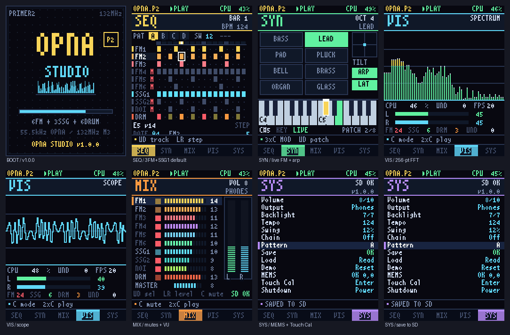
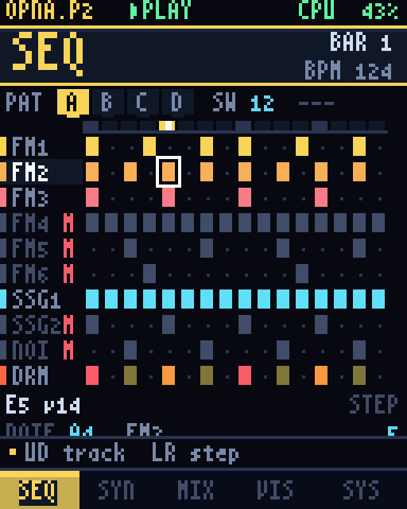
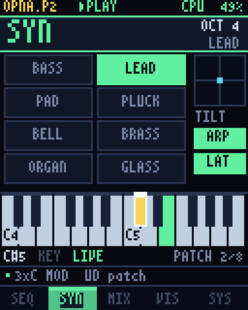
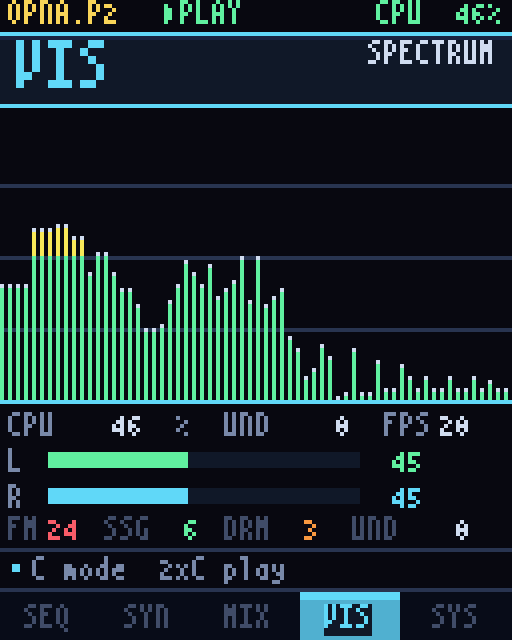
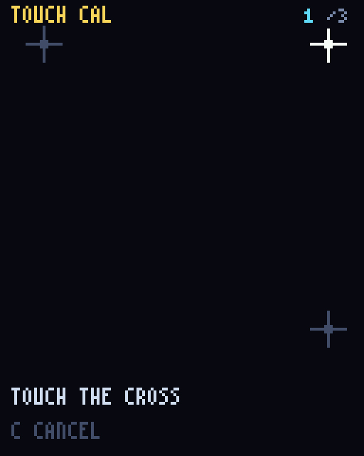

# OPNA Studio P2

<p align="center">
  
</p>

**v1.0.0 · 2026-11 · STM32 Primer2（STM32F103VET6）**

一台装进 STM32 Primer2 口袋里的 **OPNA FM 工作站**。基于 pocket-fmdsp 的
整数 OPNA 核心，重新设计并实现演奏、编曲、混音和可视化 UI；本工程是独立
仓库，没有修改参考工程。

> **演示**：[24 秒视频](docs/opna_studio_demo.mp4) ·
> [原始 WAV](docs/opna_studio_demo.wav) ·
> [频谱/时域分析](docs/spectrogram.png) ·
> [触摸校准页](docs/09_cal.png) ·
> **设计说明**：[DESIGN.md](DESIGN.md) ·
> **变更记录**：[CHANGELOG.md](CHANGELOG.md)

---

## 特性

- **15 个 OPNA 声部**：6 路 FM（每路 4 算子）、3 路 SSG（2 音色 + 1 噪声）、
  6 路 rhythm，全部在 **55 466 Hz** 原始采样率上实时合成。
  - 默认 **3 FM + SSG1 + 鼓**；FM4–6、SSG2、NOISE 在 MIX 页逐轨打开。
  - **4 FM 是当前 UI 的稳定上限**；6 FM 是 132 MHz 压力模式，详见
    [性能](#性能)。
- **10 轨 × 16 步 × 4 pattern** 步进音序器：swing、pattern A–D 链、
  每轨电平/静音、每步力度/门长，`gate=15` 为 tie。
- **8 个手工 FM 音色**：BASS / LEAD / PAD / PLUCK / BELL / BRASS / ORGAN /
  GLASS。SYN 页有 2 个八度键盘、琶音器、LATCH、倾角弯音和 FM6 live voice。
- **实时可视化**：256 点定点 FFT → 64 根对数频谱、触发式示波器、双通道
  VU、CPU / FM / SSG / drum / UND 统计；全部与音频同时运行。
- **LIS3LV02 三轴加速度计**：SYN 页倾角 ±2 半音弯音；SYS 页显示 MEMS 原始
  X/Y 和在线状态。
- **4 线电阻触摸（ADC3 / PC0–PC3）**：顶部 4 个 5 px 高按键区 + 底部 5 个
  页签；支持三点校准，矩阵保存在 STM32 备份寄存器。
- **SD 持久化**：`/opna2.p2s`（1 963 B）保存 pattern、音色、BPM、swing、
  chain、输出、背光和音量；上电自动恢复，没有卡时播放内置 demo。
- **五页像素 UI**：启动动画 + `SEQ / SYN / MIX / VIS / SYS`，沿用 pocket-fmdsp
  的深蓝/金色/青色视觉语言。
- **QEMU 自演式 demo**：24 秒自动翻完五页、演奏内置曲目，同时输出 WAV 和
  474 张 LCD 截图，可直接合成视频。

<p align="center">
  
  
  
</p>

---

## 硬件

| 部件 | 规格 |
|------|------|
| MCU | STM32F103VET6，Cortex-M3，512 kB Flash / 64 kB RAM，**132 MHz** |
| 显示 | ST7732 128×160，FSMC 8080 8-bit，`MADCTL=0xC0`（180°） |
| 输入 | 五向摇杆 PE3–PE6 + PA8；4-wire 电阻触摸 ADC3 PC0–PC3；顶部 4 个按键区 |
| 音频 | STW5094A codec，I2S3 + DMA2，55 743 Hz I2S 对 55 466 Hz 引擎 |
| 存储 | microSD（bit-bang SD-SPI + FatFs，8.3 文件名） |
| 传感器 | LIS3LV02 三轴加速度计，SPI1 PA5/6/7 + PE2 |
| 电源 | 电池/充电与关机逻辑沿用 Primer2 BSP |

---

## 快速开始

### 依赖

- `arm-none-eabi-gcc`（发布构建使用 5.4.1）、CMake、Ninja
- 可选：`qemu-system-arm`（QEMU demo）、`ffmpeg`（重新生成视频）
- Windows 下 QEMU 用完整路径或加入 `PATH`

### Host 渲染器（不接板子直接听）

```sh
cmake -S host -B build-host -G Ninja
cmake --build build-host

# 24 秒内置曲目 -> studio_demo.wav（55 466 Hz / 16-bit / stereo）
./build-host/studio_render studio_demo.wav 24
# Windows: .\build-host\studio_render.exe studio_demo.wav 24
```

Host 渲染器和固件共用 `firmware/studio/engine.c`，用于快速验证音高、电平
和 pattern 变化。

### 固件构建

```sh
cmake -S firmware -B build-fw -G Ninja \
  -DCMAKE_TOOLCHAIN_FILE=$PWD/firmware/cmake/arm-none-eabi.cmake
cmake --build build-fw
```

Windows 示例：

```bat
cmake -S firmware -B build-fw -G Ninja ^
  -DCMAKE_TOOLCHAIN_FILE=D:/Work/Primer2/opna-studio-p2/firmware/cmake/arm-none-eabi.cmake
cmake --build build-fw
```

产物：

| 文件 | 用途 |
|------|------|
| `build-fw/opna_studio_hw.hex` | 实体 Primer2 烧录 |
| `build-fw/opna_studio_hw.bin` | 裸二进制烧录 |
| `build-fw/opna_studio_hw.elf` | 调试 |
| `build-fw/opna_studio_sim.elf` | QEMU |

发布版本：

- Flash **225 652 B**；RAM **≈55.0 / 64 KiB**
- SHA256 (`opna_studio_hw.hex`)：`6bb159c7784df8692ad1ece5d239052b05a5fc80957dfb805e0207ddb83260e0`
- SHA256 (`opna_studio_hw.bin`)：`09a122c9daf8c83d8751436b233d787446239a5c247172fe7a5b2035e2e39a10`

### QEMU（完整固件 + 自动截图/录音）

```sh
qemu-system-arm -M netduino2 -cpu cortex-m3 -nographic \
  -semihosting-config enable=on,target=native \
  -kernel build-fw/opna_studio_sim.elf
```

输出：

- `sim_shot_000.ppm` …（128×160，约 20 fps）
- `sim_play_000.wav`（24 秒，55 466 Hz）
- 22.2 秒处自动执行一次 Save，写出 `opna2.p2s`

也可以用一键脚本：

```sh
QEMU="/d/Program Files/qemu/qemu-system-arm.exe" PYTHON=python scripts/run_sim.sh
```

> QEMU 没有 DWT 周期计数器，演示里的 **CPU% 是合成值**；真机 CPU 由 DWT +
> `pfm_prof_cyc` 实测。

**脚本化输入**：在 QEMU 工作目录放 `sim_input.txt`，格式为 `<ms> <mask>`，
`UP=1 DOWN=2 LEFT=4 RIGHT=8 CENTER=16`：

```
# <ms> <mask>
1200 0
1400 2
1460 0
2000 16
2100 0
```

有该文件时固件运行输入回归，否则运行内置 24 秒 demo。

### 烧录到 Primer2

- 用 ST-LINK / RLink / STM32CubeProgrammer 烧录 `opna_studio_hw.hex`；
- microSD 用 FAT32；可放 `/opna2.p2s`，上电自动恢复；
- 没有 SD 卡也能启动并播放内置 demo。

---

## 操作

五向摇杆实际是一根摇杆，`C+方向` 很难按，因此使用短按 / 双击 / 三连 / 长按：

| 手势 | 动作 |
|------|------|
| `↑ ↓ ← →` | 移动 / 选择 |
| `C` 短按 | 当前页主操作（放音符 / 弹音 / 静音 / 执行） |
| `C` 双击 | 播放 / 停止 |
| `C` 三连 | 切换 **MOD** 层；方向做精细编辑，再按三连退出（SEQ/SYN） |
| 长按 `C`（约 0.55 s） | 下一个 tab（五页循环） |

单按/双击有 250 ms 判定窗口，用来区分双击/三连。屏幕底部 hint bar 按页轮播提示。

### SEQ

| 手势 | 动作 |
|------|------|
| `↑ ↓` | 选择轨道（FM1…DRM） |
| `← →` | 选择步 |
| `C` | 放/删音符；DRM 轨循环 BD→SD→TP→HH→TM→RM→off |
| `C` 三连 → `↑ ↓` | 铅笔音高 ±1 半音（选中音符跟随） |
| `C` 三连 → `← →` | 铅笔音高 ±1 八度 |
| 长按 `↑ ↓` | 切换 pattern A–D |
| 长按 `← →` | 调整 BPM |
| `C` 双击 | 播放 / 停止 |

### SYN

| 手势 | 动作 |
|------|------|
| `← →` | 选择键（24 个半音，含黑键） |
| `↑ ↓` | 八度 2–6 |
| 按住 `C` | 弹音（松开止音） |
| `C` 三连 → `↑ ↓` | 切换 FM 音色 |
| `C` 三连 → `← / →` | 琶音器 / LATCH 开关 |
| 倾斜设备 | ±2 半音弯音（LIS3LV02） |
| `C` 双击 | 播放 / 停止 |

### MIX / VIS / SYS

- **MIX**：`↑ ↓` 选 10 轨或 MASTER；`← →` 调电平/主音量；`C` 静音
  （MASTER 上切换耳机/扬声器）；`C` 双击播放/停止。
- **VIS**：`C` 切 FFT / SCOPE；`C` 双击播放/停止。
- **SYS**：`↑ ↓` 选行；`← →` 改值；`C` 执行（Output / Chain / Save / Load /
  Demo / Touch Cal / Shutdown）；`C` 双击播放/停止。

---

## 触摸与三点校准

触摸是第二输入，不改变摇杆/C 的手势：

- **顶部 4 键区**：只取 **顶部 5 px**（状态栏），header 的 `y=5..25` 不参与，
  避免点标题误切页；从左到右对应 `SEQ / SYN / MIX / VIS`。
- **底部 tab**：直接点 `SEQ / SYN / MIX / VIS / SYS` 切页。
- **SEQ/SYN**：点网格、ruler、音色盒、键盘、ARP/LAT，只移动选择；`C` 才执行。
- **MIX/SYS**：点行选中，`C` 才执行。
- **VIS**：点内容区切 FFT/SCOPE。
- 触摸只做“点选”，没有拖拽、XY pad 或滑条。

### 校准（SYS → Touch Cal）

1. `SYS` 页选择 **Touch Cal**，按 `C`；
2. 依次点击三个十字：`(115,15)`、`(115,115)`、`(15,15)`；
3. 第三点后显示 `SAVE OK`，1.5 秒后自动退出；`C` 可随时取消；
4. 六个原始点写入 BKP_DR2..7（magic `0x5A5A`），上电重算矩阵；
5. 未校准或备份域失效时退回 Chopstx 的固定映射。

<p align="center">
  
</p>

> 备份域靠 VBAT 电池保持；电池没电后校准会丢，重新跑一次即可。
> 触摸偏移主要来自面板个体差异，三点校准会把它拟合成屏幕坐标。

---

## SD 持久化

- 文件：`/opna2.p2s`，**1 963 B**，packed，magic `OPN2`，version 2；
- 保存内容：4 个 pattern × 10 轨 × 16 步、6 个 FM patch、BPM、swing、
  chain、pattern 选择、音量、背光、输出；
- 保存时短暂静音，写完重启音频，尽量避免 SD 写阻塞造成 underrun；
- v1 旧存档自动迁移：FM4–6 / SSG2 / NOISE 强制静音，pattern 保留；
- pattern chain 默认 **Off**，`SYS → Chain` 可开；旧存档或 SYS Demo 可能带 On。

---

## 性能

上板实测（DWT，CPU 占单核百分比）：

| 配置 | CPU |
|------|-----|
| 旧版 6 FM | **107%** |
| 旧版 3 FM | **80–90%** |
| 旧版 3 FM，暂停 | **57%** |
| **v1.0 默认：3 FM + SSG1 + 鼓** | **40–50%** |
| 同上，暂停 | **0%** |
| 全部 6 FM + SSG2/NOISE + 鼓 | **≈80%** |

关键优化：

- 默认只留 SSG1；FM4–6、SSG2、NOISE 静音；
- SSG 动态 mask：三路都静音时整个 SSG mixer 跳过；
- 暂停/停止真正停渲染：`studio_is_idle()` 时只写静音，不调用
  `studio_render()`；
- FFT/scope 只在 VIS 跑，VU 只在 MIX 跑；
- `studio_render()`、master gain、capture 放进 `.ramfunc`；
- LCD task 只在 `board_audio_ring_fill() > 512` 时画一帧；
- 输入只重绘 dirty rect，VIS 先画进 SRAM canvas 再一次性 flush。

> SYN 页的 live voice 会临时启用 FM6，所以 SYN 上实际是 **4 FM**；这仍在稳定
> 上限内。默认 3 FM 指 SEQ/MIX 等页面的音序器混音。

**4 FM 是当前 UI 的稳定上限**：上板实测 4 FM 时 UND 不增长，5 FM 开始增长，
6 FM 快速增长。6 FM 只作为压力测试模式；要稳定使用请留在 4 FM 以内，或关闭
VIS 实时 FFT、SSG2、NOISE。

> QEMU 截图里的 CPU% 是合成值；真机数据以上表为准。

---

## 显示与局部刷新

ST7732 没有双缓冲，TE 引脚在 Primer2 上未接到 MCU，因此不能做硬件 tearing
同步。显示路径采用 **partial / dirty rendering**：

- **页面切换**：整页清屏 + `ui_draw()`，一次；
- **输入**：`ui_draw_dirty()`，BSP 的 clip rect 只写旧/新 cell、row、key、
  footer、hint；
- **SEQ pattern 链**：`ui_redraw_pattern()`，只画 header 右侧、pattern 条、
  ruler、网格、footer；
- **稳态**：`ui_anim()` 只画 ruler、CPU、hint、VU、FFT、tilt 等小区域；
- **VIS**：128×73 离屏 canvas，画完一次性 flush，面板看不到空白中间帧。

跨任务状态分两层：app 只改 `U`，`publish()` 写 `V_live`；LCD 每帧在临界区
把 `V_live` 快照到 `V`，并在同一临界区取走 dirty 列表。这样 app 在 draw
中途 publish 不会污染当前帧，也不会丢掉下一帧的 dirty。

> 残余 tearing 只剩页面切换和 VIS canvas flush（动画内容本身）；如果输入时
> 还能看到整页闪，请记录页面和动作。

---

## 架构

```
                 ┌──────────────── firmware/studio/engine.c ───────────────┐
 10 tracks       │ 16-step scheduler @ 55 466 Hz (sample-accurate events)  │
 4 patterns      │ live layer (FM6): keyboard / arp / latch / tilt bend     │
                 │ direct OPNA register writes                             │
                 └───────────────┬─────────────────────────────────────────┘
                                 │
    
                 ┌───────────────▼───────────────┐
                 │ src/opna/ (bit-exact core)    │
                 │ 6×FM + 3×SSG + 6×rhythm      │
                 └───────┬───────────────┬───────┘
                         │               │ mono capture
                 master gain ×3          ▼
                         │       256-pt FFT / scope / VU
                         ▼               │
              DMA ring (18 ms)           │
                         │               │
                 STW5094A codec     LCD task (20 fps)
```

- **采样级音序器**：`step_frames = 55 466 × 60 / (BPM × 4)`；swing 只延后奇数
  16 分音符。事件在精确采样帧写入 OPNA，不是每 tick 轮询。
- **声音**：FM 参数以物理 slot 顺序 S1/S3/S2/S4 存储；SSG voltable ×4 以平衡
  FM/鼓（唯一的声音电平改动，FM/鼓路径保持 bit-exact）。
- **任务**：`app`（prio 2）音频 + 输入；`lcd`（prio 1）20 fps；音频永远抢占
  LCD。VIS/FFT 在最低优先级任务里跑。
- 更细的寄存器、内存预算、文件格式和算法见 **[DESIGN.md](DESIGN.md)**。

---

## 资源占用

| 项目 | 大小 |
|------|------|
| Flash load image（`.text`/`.data`/`.ramfunc` 初值） | **225 652 B** |
| `.ramfunc`（运行时复制到 SRAM） | 9 672 B |
| `.data` | 1 200 B |
| `.bss` | **43 424 B** |
| MSP 栈 reserve | 2 048 B |
| RAM 实际 | 1 200 + 9 672 + 43 424 + 2 048 ≈ **55.0 KiB / 64 KiB** |
| 结论 | 64 KiB RAM 约 9 KiB 余量；512 KiB Flash 余量更大 |

`.text` 的大项：72 kB 字体、约 112 kB 鼓 PCM、FatFs/FreeRTOS 和 OPNA 核心。
RAM 大项：VIS canvas 18.7 kB、`.ramfunc` 9.7 kB、audio ring 4 kB、OPNA/歌曲/
FFT/文件缓冲各约 2 kB、任务栈 6.5 kB。

QEMU 目标 `.bss` **63 872 B**，其中 40 960 B 是 128×160 RGB565 截屏 framebuffer。

---

## 目录

```
opna-studio-p2/
├── firmware/
│   ├── studio/          engine.c 音序器/合成；ui.c 五页 UI；fft.c；app.c
│   ├── bsp/primer2/     FSMC LCD、摇杆、I2S codec、SD、LIS3LV02、触摸、关机
│   ├── bsp/sim/         QEMU 语义半主机：PPM、WAV、文件、合成 tilt
│   ├── gui/             Misaki 8×8 字体 + 快速文字渲染
│   ├── freertos/ fatfs/ 内核与文件系统（静态分配 / 8.3 文件名）
│   ├── app/             main_hw.c / main_sim.c
│   ├── ld/ startup/     Cortex-M3 启动与链接脚本
│   └── tools/           notes / FFT 表生成器
├── src/opna/            OPNA 核心（来自 pocket-fmdsp，SSG 电平 ×4）
├── include/pfm/         核心头文件
├── host/                host 渲染器
├── docs/                截图、视频、WAV、频谱、校准页
├── scripts/             一键 QEMU 采集
├── DESIGN.md
├── NOTICE.md
├── CHANGELOG.md
└── LICENSE              Apache-2.0
```

---

## 验证状态与已知限制

**已验证**

- Host / ARM 两个目标从干净目录构建通过；尺寸如上。
- **上板**：音频、摇杆、触摸、MEMS、顶部 4 键（5 px）均可用；SD 保存/加载由
  QEMU + 参考 BSP 验证。
- **CPU**：默认 3 FM + SSG1 + 鼓 **40–50%**，暂停 **0%**；全部通道约 **80%**。
- **UND**：4 FM 不增长；5 FM 开始；6 FM 快速增长。**4 FM 是稳定上限**。
- **QEMU**：24 秒 demo 的 474 帧、WAV、五页 UI、FFT、示波器、VU、SD 存盘、
  三点校准页均正常；校准页截图见 [docs/09_cal.png](docs/09_cal.png)。
- **修复**：app/LCD 的 V/publish 竞态（局部刷新偶发不清除）；`publish()` 漏拷
  `cal` 字段导致校准页只全刷不显示；顶部 4 键 Y 范围过大导致 header 误触。

**已知限制**

- **6 FM 是压力模式**：约 80% CPU，5/6 FM 的 UND 会增长；稳定使用请留在 4 FM。
- **残余 tearing**：页面切换和 VIS canvas flush 是整块写入；TE 未接线，无法
  做硬件同步。输入路径已尽量局部化。
- **触摸校准依赖 VBAT**：备份域没电后校准丢失，需要重跑；触摸偏移是面板
  个体差异，不是软件 bug。
- **触摸只做点选**：没有拖拽、XY pad、滑条。
- **codec 采样率**：I2S 55 743 Hz vs 引擎 55 466 Hz（+0.5%，约 8 cent），沿用
  参考 BSP 的取舍。
- **未实现**：ADPCM-B / PPZ8 流式播放、USB-MIDI、演奏录音写 SD、电池电量。

---

## 致谢与许可

- **pocket-fmdsp**：OPNA 核心与 Primer2 BSP 基础（Apache-2.0）。
- **libopna / 98fmplayer**：OPNA 正确性参考，BSD-2-Clause，© 2016 Takamichi
  Horikawa。
- **Chopstx**：4-wire 触摸 ADC 换算参考（`example-primer2/primer2-ts.c`）。
- **CircleOS（Keolabs）**：三点触摸校准的仿射公式参考
  `TOUCHSCR_CalculateCalibration()`；原始三点校准样例由 Carlos E. Vidales
  放入 public domain。
- **Misaki gothic 8×8**：public domain 字体。
- **FreeRTOS**（MIT）与 **FatFs**（BSD-1-Clause）：见各自源码头。

本工程的 engine / UI / demo / 文档为原创。完整归属、第三方代码清单与修改说明
见 **[NOTICE.md](NOTICE.md)**；许可证见 **[LICENSE](LICENSE)**（Apache-2.0）。

---

<p align="center"><i>OPNA Studio P2 · 132 MHz · 55 466 Hz · 15 voices · 10 tracks · 5 pages</i></p>
